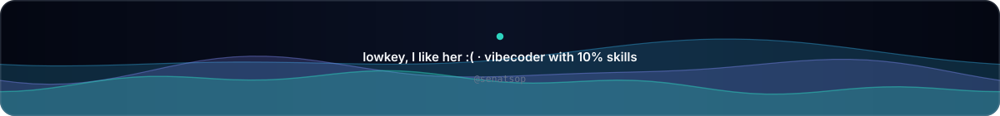

<picture>
  <source media="(prefers-color-scheme: dark)" srcset="./assets/hero-dark.svg" />
  <source media="(prefers-color-scheme: light)" srcset="./assets/hero-light.svg" />
  
</picture>

 

  
  
  

 

<picture>
  <source media="(prefers-color-scheme: dark)" srcset="./assets/bento-dark.svg" />
  <source media="(prefers-color-scheme: light)" srcset="./assets/bento-light.svg" />
  
</picture>

 

<h3>Featured Builds</h3>

  <a href="https://github.com/senatsop/IM-Project"><picture>
  <source media="(prefers-color-scheme: dark)" srcset="./assets/proj-1-dark.svg" />
  <source media="(prefers-color-scheme: light)" srcset="./assets/proj-1-light.svg" />
  
</picture></a>
  &nbsp;
  <a href="https://github.com/senatsop/StarFighting-magig"><picture>
  <source media="(prefers-color-scheme: dark)" srcset="./assets/proj-2-dark.svg" />
  <source media="(prefers-color-scheme: light)" srcset="./assets/proj-2-light.svg" />
  
</picture></a>

  <a href="https://github.com/senatsop/clash-royale"><picture>
  <source media="(prefers-color-scheme: dark)" srcset="./assets/proj-3-dark.svg" />
  <source media="(prefers-color-scheme: light)" srcset="./assets/proj-3-light.svg" />
  
</picture></a>
  &nbsp;
  <a href="https://github.com/balumageorgejr-afk/IslandBox"><picture>
  <source media="(prefers-color-scheme: dark)" srcset="./assets/proj-4-dark.svg" />
  <source media="(prefers-color-scheme: light)" srcset="./assets/proj-4-light.svg" />
  
</picture></a>

 

<h3>Tech Stack &amp; Arsenal</h3>

  
  
  
  
  
  
  
  
  
  

 

<h3>Live Telemetry</h3>

  
  

 

<picture>
  <source media="(prefers-color-scheme: dark)" srcset="./assets/footer-dark.svg" />
  <source media="(prefers-color-scheme: light)" srcset="./assets/footer-light.svg" />
  
</picture>

